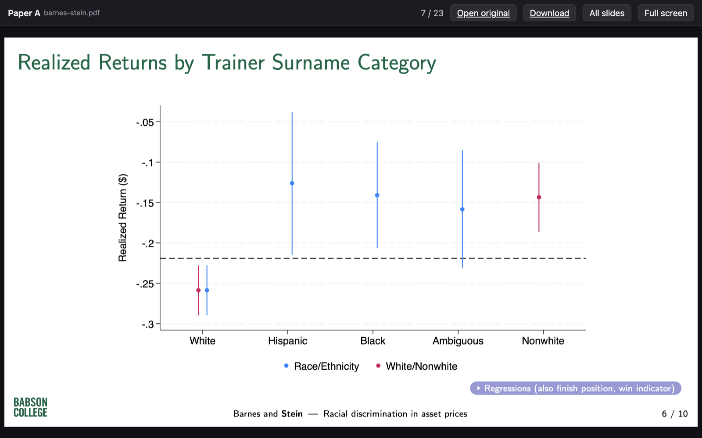
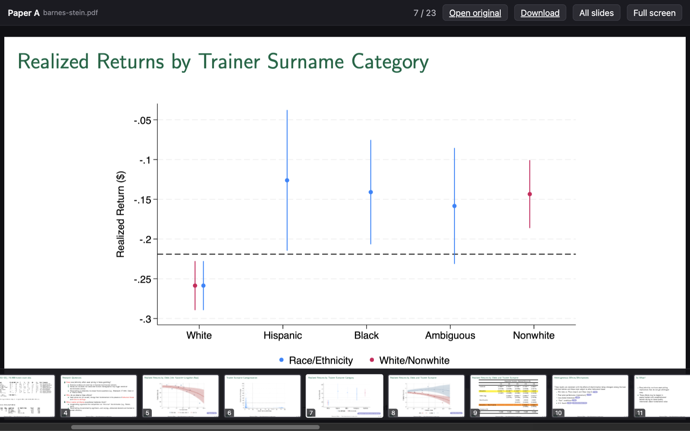
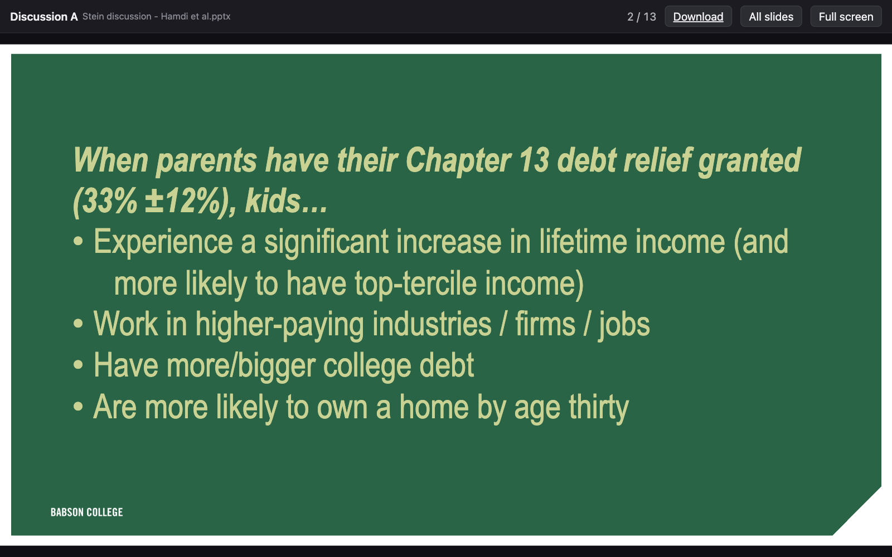

# Session Slides Organizer

**Hosted at <https://lukestein.com/session-slides-organizer/>.** Open it in your browser and start dropping in slides. There is nothing to install and no account to make, and your files are read on your own computer, not uploaded anywhere.

https://github.com/user-attachments/assets/21a3cc7f-5a1a-4f88-949c-9c13e6312e4a

A small web tool for whoever runs a conference session, a seminar, or a panel. When several speakers share one room computer, the usual scramble is a pile of files in Downloads, a different app for each format, and a laptop-swap between every talk. Here you put all the presentations in one list, put them in speaking order, and open each one at its turn. PDFs, PowerPoint and Keynote files all go in the same list.

- **One list, in speaking order.** Drag talks to reorder them, and give each a clean display title.
- **Present from the browser.** PDFs and PowerPoint files open in their own tab, one slide at a time, ready to send to the projector.
- **A ZIP of the whole session.** Numbered, named in order, with a `session.md` running order beside the presentation files. Drop that ZIP back in later to pick up exactly where you left off.
- **Online presentations too.** Paste a link to Google Slides, Canva, PowerPoint for the web or anywhere else, and it takes its place in the running order.
- **Private by design.** The organizer has no server side. Nothing is uploaded, there is nothing to sign in to, and there is no tracking or analytics.
- **Nothing lost to a refresh.** The list is kept in this browser until you clear it, so a closed tab or a restarted computer picks up where it was.

## How it works

### 1. Drop your slides in

Drag PDFs, PowerPoint or Keynote files, or a saved session ZIP onto the page, or click **+** to choose them. Each presentation gets a row with a preview of its first slide, its file size, and its page or slide count when it can be read.

For a presentation that lives online, paste its link into the field under **Drop slides here**, or anywhere on the page, or drag it in from another tab. See **Online presentations** below.

### 2. Name and order the talks

- **Rename** a talk by typing in its title field. Press **Tab** to move to the next title.
- **Reorder** by dragging a row by its handle. On a touch screen, use the handle too. With a keyboard, focus the handle and press the up or down arrow key.
- **Remove** a talk with the trash button.

### 3. Present from the browser

**Open in browser** opens the presentation in a new tab, so the presenter's view can go to the projector while the list stays on the laptop. PDFs and PowerPoint files use the same presenter, with the same keys.

Press **G** to see every slide as a strip of thumbnails along the bottom, and click one to jump to it.

PowerPoint slides play their click-by-click builds, as PowerPoint does.

Press **?** at any time for the shortcut guide.

#### Presenter keyboard shortcuts

| Key | Does |
| --- | --- |
| → ↓ Space Page Down | Next slide, or the next click-by-click build |
| ← ↑ Page Up | Previous |
| Home / End | First / last slide |
| **B** / **W** | Blank the screen black or white, as in PowerPoint |
| **G** | Show all slides as thumbnails along the bottom; click one to jump |
| **?** or **/** | Show the keyboard guide |
| **Esc** | Close the guide or the slide picker |

Presentation clickers work too, since both the arrow keys and the Page keys move. You can also click the outer eighth of either side of a slide to move on. Links inside a PDF still work, including jumps to another page, and a link at the very edge of a page takes its own click. The **All slides** and **Full screen** buttons in the top bar do the same as **G** and the browser's own full screen. In full screen the bar hides until the pointer reaches the top.

Coming back from a blank screen returns to the slide that was up, so a key pressed to wake the screen does not cost a slide.

The presentation is read into memory before it is shown, so closing the organizer tab or removing the row cannot interrupt a talk in progress.

### 4. Download the session

**Download session ZIP** bundles the presentation files, in speaking order, without leaving your computer. Name the ZIP in the field beside the button, then download it.

- Each file is named for its position, title and original type, as in `2. Opening paper.pptx`. If the title is blank or unchanged, the original filename follows the position instead.
- Positions are padded with zeros when there are enough talks to need it, so sorting by filename keeps the order.
- A `session.md` goes in alongside the files, listing the running order in plain Markdown, so a printed or emailed ZIP still makes sense to a human.

You can also download any single presentation from its row, with the same numbered name.

### 5. Pick the session up again

Drop a session ZIP back onto the page and the running order returns, titles and all. Things to know:

- It adds to the end of whatever is already listed, so two sessions can be combined.
- A talk that is already in the list is not added a second time, even if the file has been renamed since. Dropping the same ZIP twice leaves the list as it is and says which talks were already there.
- It does not have to stay a ZIP. Unpack it and drag the files in, `session.md` among them, and the order is applied just the same.
- You can edit `session.md` by hand. Reorder its lines or rewrite a title and the import follows. A presentation in the ZIP that `session.md` does not mention is still added, after the ones it does, so nothing is silently dropped.

### Online presentations

A link row stands in the running order like any other talk, with a web icon where the preview would be. **Open link** opens it on its own site in a new tab, to present with that service's own presenter. Links need the internet at presenting time.

Google Slides links do more, for presentations shared with **Anyone with the link**:

- **A preview and the presentation's name** arrive as soon as the link is added. Google does not say how many slides there are until the whole PDF is fetched, so the count waits for **Get PDF**. If the preview cannot be loaded (a private presentation, or no network yet), the web icon stays, and clicking it tries again.
- **Get PDF** fetches a PDF copy from Google into the list. The row becomes an ordinary PDF row, so it presents in the organizer's own presenter, works offline, and goes in the session ZIP. A small **Google Slides ↗** link beside the filename still opens the live presentation. Its buttons carry a dagger (†) pointing at what the PDF leaves out: each slide appears in its finished state, without animations or transitions, and video and audio don't play.

Both ask Google anonymously, without your Google sign-in, which is why a private presentation is refused. When **Get PDF** is refused, the organizer offers a **Download the PDF from Google** link, which downloads it in your own browser, signed in. Drop the downloaded file into the list.

**A link straight to a file**, such as `https://example.github.io/talk.pdf`, is downloaded as soon as you add it, when the site allows it. The row becomes a file row with a small link to its source. Many sites, including GitHub Pages, allow this. Many university and file-sharing sites don't. Then the row stays a link, and if the address ends in a slide filename the organizer says so and offers the link to download it yourself. Such a row also gets a **Get file** button, to try again once the site is back up, or after a session ZIP brings the row back without its file. ZIP import works offline using the files in the archive. With internet access, it can also load previews for restored Google Slides links. Use **Get file** or **Get PDF** to download the presentation for a restored link.

**Refresh** appears beside the source link on any row fetched from a link, Google Slides included. It downloads the current version, in case the speaker has changed it, and keeps the row's position and any title you typed. It says when nothing has changed, and when the page count has. It only runs when you click it, so a presentation never changes under you mid-session.

Other services keep their presentations behind their own sign-in and offer no comparable export, so their rows are links only. In the session ZIP, a link is a line in `session.md` rather than a file, and comes back when the ZIP is dropped in again.

If you import a session ZIP with a saved copy for a link-only row, the row keeps its position and any title you entered. **Open in browser** presents the saved PDF, and **Google Slides ↗** opens the current online presentation. If the row already has a PDF, it keeps that copy.

## Good to know

**Your list stays on this computer.** There is no account and nothing is saved on a server. Apart from PairDrop, the page contacts only the sites you link to: Google for the preview and name of a Google Slides link when you add one and for its PDF when you click **Get PDF**, and any other link's own site once, when you add it, to see whether it is a slide file. **Refresh** asks again only when clicked. None of these requests carries your cookies or the page's address. The list, files included, is kept in this browser's own storage on this computer, so a refresh, a crash or a closed tab does not lose it. Open the page again and it comes back. **Clear list**, under the session ZIP row, removes it. On a shared room computer, clear the list when your session is done, and download the session ZIP if you want to keep the running order elsewhere. If the page is open in two tabs, only the first keeps the list saved, and the second says so.

**It works offline.** After the page has been opened once with internet, this browser keeps a copy of it, so it opens again with no connection: handy when the room's Wi-Fi is down or wants a sign-in. Your saved list comes back too, and PDFs and PowerPoint files present as usual. Only online presentations and fetching from links need the internet. When setting up a room computer, open the page once while it is online. Online, updates arrive just as they would without it.

**What can be opened.**

| Format | Preview, size and count | Present in the browser | Download and ZIP |
| --- | --- | --- | --- |
| PDF | Yes | Yes, links included | Yes |
| PowerPoint: `.pptx` `.pptm` `.ppsx` `.ppsm`, and the older `.ppt` `.pps` | Yes | Yes | Yes |
| Keynote `.key` | Preview of the first slide only | **No** | Yes |
| Link to Google Slides | From Google, with the presentation's name. Page count once a PDF is available | On Google, or here with a fetched or restored PDF | PDF and source link when a PDF is available. Link in `session.md` for a link-only row |
| Link straight to a PDF or PowerPoint file | As a PDF or PowerPoint, when the site allows the download | Here, as a PDF or PowerPoint | The file and its source link, when downloaded. Otherwise a line in `session.md` |
| Link to anything else | No | On its own site | A line in `session.md` |

- **Keynote files cannot be shown in the browser.** Apple keeps the slides in a format with no public specification, and no browser-side reader for it exists. A Keynote row still has its preview, a Download button, and a place in the ZIP. To present one from the browser, use **File → Export To** in Keynote and choose PDF or PowerPoint. Some `.key` files are folders rather than single files, and those cannot be added to the list at all.
- **PowerPoint slides are close to, but not exactly, what PowerPoint shows.** Text can wrap differently, and presentations that use fonts the room computer does not have will substitute others, as they would in PowerPoint itself. PowerPoint rows carry an asterisk as a reminder. For a talk where every detail matters, use **Download** and present from PowerPoint.
- **PDFs in the presenter give up the browser's own viewer around the page,** meaning its toolbar, printing, and find across the whole document. The **Open original** button in the presenter bar hands the file to the browser's own PDF viewer for all of that.
- **Full screen** uses the browser's own full-screen mode. If a browser refuses it, the button names that browser's own shortcut, and the presenter fills its tab either way.

**Receiving slides from speakers (optional).** If speakers are not in the room with a USB stick, **Receive with PairDrop** opens a temporary room on the third-party [PairDrop](https://pairdrop.net/) service in a separate tab. Speakers join with the QR code or room code and send one file at a time. Accept each in PairDrop, return to the organizer, and click **Import received files**, or drop the downloaded file into the list. PairDrop only runs when you click it, and apart from Google Slides links it is the only part of the tool that involves another service.

Tip for a shared room computer: in PairDrop, set that browser's display name to something like **Presentation Computer**, so speakers know which device to pick. PairDrop remembers the name in that browser profile.

## License and credits

Session Slides Organizer is free to use and open source under the [MIT license](LICENSE). It is built on [PDF.js](https://mozilla.github.io/pdf.js/) (Apache 2.0) for PDFs, [web-ppt](https://github.com/unStone/web-ppt) (MIT) for PowerPoint and [fflate](https://github.com/101arrowz/fflate) (MIT) for ZIPs, and set in [Instrument Sans](https://github.com/Instrument/instrument-sans) (SIL Open Font License). Each one's license is bundled beside it in [`docs/vendor/`](docs/vendor/).

Working on the code, by hand or with a coding agent? See [DEVELOPING.md](DEVELOPING.md).
