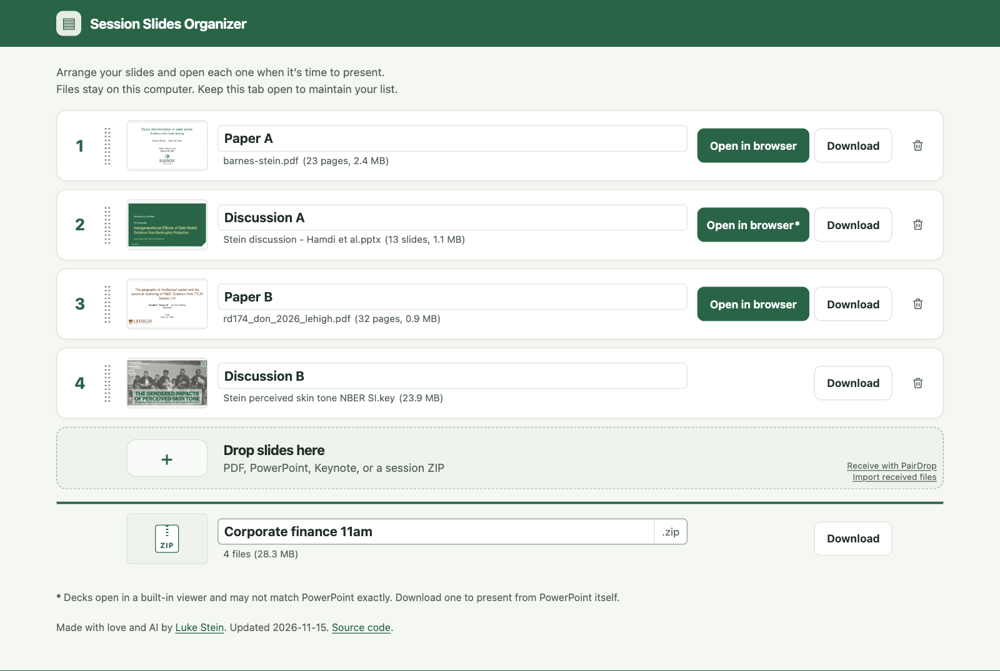
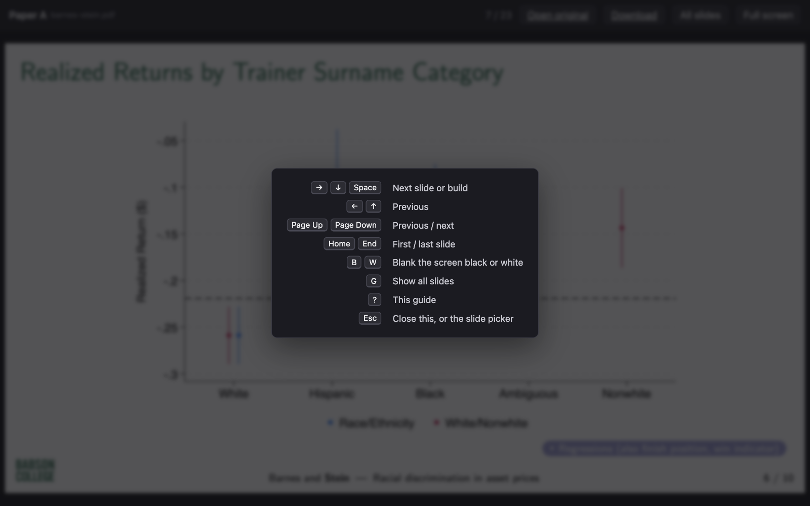

# Session Slides Organizer

**Hosted at <https://lukestein.com/session-slides-organizer/>.** Open it in your browser and start dropping in slides. There is nothing to install and no account to make, and your files are read on your own computer, not uploaded anywhere.

https://github.com/user-attachments/assets/21a3cc7f-5a1a-4f88-949c-9c13e6312e4a

A small web tool for whoever runs a conference session, a seminar, or a panel. When several speakers share one room computer, the usual scramble is a pile of files in Downloads, a different app for each format, and a laptop-swap between every talk. Here you put all the decks in one list, put them in speaking order, and open each one at its turn. PDFs, PowerPoint decks and Keynote files all go in the same list.

- **One list, in speaking order.** Drag talks to reorder them, and give each a clean display title.
- **Present from the browser.** PDFs and PowerPoint decks open in their own tab, one slide at a time, ready to send to the projector.
- **A ZIP of the whole session.** Numbered, named in order, with a `session.md` running order beside the decks. Drop that ZIP back in later to pick up exactly where you left off.
- **Online decks too.** Paste a link to Google Slides, Canva, PowerPoint for the web or anywhere else, and it takes its place in the running order.
- **Private by design.** The organizer has no server side. Nothing is uploaded, and there is nothing to sign in to.

## How it works

### 1. Drop your slides in

Drag PDFs, PowerPoint decks, Keynote files, or a saved session ZIP onto the page, or click **+** to choose them. Each deck gets a row with a preview of its first slide, its file size, and its page or slide count when it can be read.

For a deck that lives online, paste its link into the field under **Drop slides here**, or anywhere on the page, or drag it in from another tab. See **Online decks** below.

### 2. Name and order the talks



- **Rename** a talk by typing in its title field. Press **Tab** to move to the next title.
- **Reorder** by dragging a row by its handle. On a touch screen, use the handle too. With a keyboard, focus the handle and press the up or down arrow key.
- **Remove** a talk with the trash button.

### 3. Present from the browser

**Open in browser** opens the deck in a new tab, so the presenter's view can go to the projector while the list stays on the laptop. PDFs and PowerPoint decks use the same presenter, with the same keys.


Press **G** to see every slide as a strip of thumbnails along the bottom, and click one to jump to it.


PowerPoint decks play their click-by-click builds, as PowerPoint does.


Press **?** at any time for the shortcut guide.



#### Presenter keyboard shortcuts

| Key | Does |
| --- | --- |
| → ↓ Space Page Down | Next slide, or the next click-by-click build |
| ← ↑ Page Up | Previous |
| Home / End | First / last slide |
| **B** / **W** | Blank the screen black or white, as in PowerPoint |
| **G** | Show all slides as thumbnails along the bottom; click one to jump |
| **?** or **/** | Show the keyboard guide |
| **Esc** | Close the guide or the slide picker |

Presentation clickers work too, since both the arrow keys and the Page keys move. You can also click the outer eighth of either side of a slide to move on. Links inside a PDF still work, including jumps to another page, and a link at the very edge of a page takes its own click. The **All slides** and **Full screen** buttons in the top bar do the same as **G** and the browser's own full screen. In full screen the bar hides until the pointer reaches the top.

Coming back from a blank screen returns to the slide that was up, so a key pressed to wake the screen does not cost a slide.

The deck is read into memory before it is shown, so closing the organizer tab or removing the row cannot interrupt a talk in progress.

### 4. Download the session

**Download session ZIP** bundles the decks, in speaking order, without leaving your computer. Name the ZIP in the field beside the button, then download it.

- Each deck is named for its position, title and original type, as in `2. Opening paper.pptx`. If the title is blank or unchanged, the original filename follows the position instead.
- Positions are padded with zeros when there are enough talks to need it, so sorting by filename keeps the order.
- A `session.md` goes in alongside the decks, listing the running order in plain Markdown, so a printed or emailed ZIP still makes sense to a human.

You can also download any single deck from its row, with the same numbered name.

### 5. Pick the session up again

Drop a session ZIP back onto the page and the running order returns, titles and all. Things to know:

- It adds to the end of whatever is already listed, so two sessions can be combined.
- A talk that is already in the list is not added a second time, even if the file has been renamed since. Dropping the same ZIP twice leaves the list as it is and says which talks were already there.
- It does not have to stay a ZIP. Unpack it and drag the files in, `session.md` among them, and the order is applied just the same.
- You can edit `session.md` by hand. Reorder its lines or rewrite a title and the import follows. A deck in the ZIP that the file does not mention is still added, after the ones it does, so nothing is silently dropped.

### Online decks

A link row stands in the running order like any other talk, with a web icon where the preview would be. **Open link** opens it on its own site in a new tab, to present with that service's own presenter. Links need the internet at presenting time.

Google Slides links do more, for decks shared with **Anyone with the link**:

- **A preview and the deck's name** arrive as soon as the link is added. Google does not say how many slides there are until the whole PDF is fetched, so the count waits for **Get PDF**. If the preview cannot be loaded (a private deck, or no network yet), the web icon stays, and clicking it tries again.
- **Get PDF** fetches a PDF copy from Google into the list. The row becomes an ordinary PDF row, so it presents in the organizer's own presenter, works offline, and goes in the session ZIP. A small **Google Slides ↗** link beside the filename still opens the live deck. Its buttons carry a dagger (†) pointing at what the PDF leaves out: each slide appears in its finished state, without animations or transitions, and video and audio don't play.

Both ask Google anonymously, without your Google sign-in, which is why a private deck is refused. When **Get PDF** is refused, the organizer offers a **Download the PDF from Google** link, which downloads it in your own browser, signed in. Drop the downloaded file into the list.

**A link straight to a file**, such as `https://example.github.io/talk.pdf`, is downloaded as soon as you add it, when the site allows it. The row becomes an ordinary PDF or PowerPoint row, with a small link to where it came from. Many sites, including GitHub Pages, allow this. Many university and file-sharing sites don't. Then the row stays a link, and if the address ends in a slide filename the organizer says so and offers the link to download it yourself. Such a row also gets a **Get file** button, to try again once the site is back up, or after a session ZIP brings the row back without its file. Importing a ZIP never downloads anything on its own, so it works offline.

**Refresh** appears beside the source link on any row fetched from a link, Google Slides included. It downloads the current version, in case the speaker has changed the deck, and keeps the row's position and any title you typed. It says when nothing has changed, and when the page count has. It only runs when you click it, so a deck never changes under you mid-session.

Other services keep their decks behind their own sign-in and offer no comparable export, so their rows are links only. In the session ZIP, a link is a line in `session.md` rather than a file, and comes back when the ZIP is dropped in again.

If you import a session ZIP with a saved copy for a link-only row, the row keeps its position and any title you entered. **Open in browser** presents the saved PDF, and **Google Slides ↗** opens the current online deck. If the row already has a PDF, it keeps that copy.

## Good to know

**Your list lives in the open tab.** There is no account and nothing is saved on a server. Apart from PairDrop, the page contacts only the sites you link to: Google for the preview and name of a Google Slides link when you add one and for its PDF when you click **Get PDF**, and any other link's own site once, when you add it, to see whether it is a slide file. **Refresh** asks again only when clicked. None of these requests carries your cookies or the page's address. Closing the tab clears the list, so download the session ZIP if you want to keep your running order.

**What can be opened.**

| Format | Preview, size and count | Present in the browser | Download and ZIP |
| --- | --- | --- | --- |
| PDF | Yes | Yes, links included | Yes |
| PowerPoint: `.pptx` `.pptm` `.ppsx` `.ppsm`, and the older `.ppt` `.pps` | Yes | Yes | Yes |
| Keynote `.key` | Preview of the first slide only | **No** | Yes |
| Link to Google Slides | From Google, with the deck's name. Page count once a PDF is available | On Google, or here with a fetched or restored PDF | PDF and source link when a PDF is available. Link in `session.md` for a link-only row |
| Link straight to a PDF or PowerPoint file | As a PDF or PowerPoint, when the site allows the download | Here, as a PDF or PowerPoint | The file and its source link, when downloaded. Otherwise a line in `session.md` |
| Link to anything else | No | On its own site | A line in `session.md` |

- **Keynote decks cannot be shown in the browser.** Apple keeps the slides in a format with no public specification, and no browser-side reader for it exists. A Keynote row still has its preview, a Download button, and a place in the ZIP. To present one from the browser, use **File → Export To** in Keynote and choose PDF or PowerPoint. Some `.key` files are folders rather than single files, and those cannot be added to the list at all.
- **PowerPoint decks are close to, but not exactly, what PowerPoint shows.** Text can wrap differently, and decks that use fonts the room computer does not have will substitute others, as they would in PowerPoint itself. PowerPoint rows carry an asterisk as a reminder. For a talk where every detail matters, use **Download** and present from PowerPoint.
- **PDFs in the presenter give up the browser's own viewer around the page,** meaning its toolbar, printing, and find across the whole document. The **Open original** button in the presenter bar hands the file to the browser's own PDF viewer for all of that.
- **Full screen** uses the browser's own full-screen mode. If a browser refuses it, the button names that browser's own shortcut, and the presenter fills its tab either way.

**Receiving slides from speakers (optional).** If speakers are not in the room with a USB stick, **Receive with PairDrop** opens a temporary room on the third-party [PairDrop](https://pairdrop.net/) service in a separate tab. Speakers join with the QR code or room code and send one deck at a time. Accept each in PairDrop, return to the organizer, and click **Import received files**, or drop the downloaded deck into the list. PairDrop only runs when you click it, and apart from Google Slides links it is the only part of the tool that involves another service. It is still waiting on a test on a real classroom computer; see the To do list below.

Tip for a shared room computer: in PairDrop, set that browser's display name to something like **Presentation Computer**, so speakers know which device to pick. PairDrop remembers the name in that browser profile.

---

# For developers

Everything below is for people (and coding agents) working on the code. The site is plain static files in `docs/`, with no build step, backend, or runtime CDN dependency.

## Run locally

From the repository root, run:

```sh
python3 -m http.server 8000 --bind 127.0.0.1 --directory docs
```

Open <http://127.0.0.1:8000/>. PDF.js 6.5.438 and fflate 0.8.3 are bundled under `docs/vendor/` with their licenses.

Run the tests with `node --test tests/`.

## Project layout

| Path | What it is |
| --- | --- |
| `docs/index.html`, `docs/styles.css` | The organizer page, with its Content Security Policy |
| `docs/app.mjs` | The list: adding, renaming, reordering, removing, downloading |
| `docs/previews.mjs` | First-page thumbnails, slide counts and sizes |
| `docs/deck-viewer.mjs` | Which formats can be presented, and the blob-URL handoff to the presenter tab |
| `docs/present.html`, `docs/present.mjs` | The presenter shell: bar, keys, blanking, slide picker, full screen |
| `docs/deck-pdf.mjs`, `docs/deck-pptx.mjs` | One rendering engine per format, behind the presenter |
| `docs/session-zip.mjs`, `docs/session-manifest.mjs`, `docs/session-import.mjs`, `docs/file-identity.mjs` | Writing a session ZIP and its `session.md`, and reading one back without listing a talk twice |
| `docs/links.mjs` | Reading a pasted link, fetching a PDF or preview from Google Slides, and fetching a file a link points straight at |
| `docs/vendor/` | Bundled third-party code: PDF.js, fflate, web-ppt, with licenses |
| `media/` | The demo video and screenshots this README embeds |
| `demo-recorder/` | The rig that records the video and takes the screenshots; see its own README |

## Publish with GitHub Pages

The live site is the `/docs` folder of `main`, served by GitHub Pages at <https://lukestein.com/session-slides-organizer/>. To publish a copy, push `main` to a GitHub repository. In **Settings → Pages**, select **Deploy from a branch**, then choose **main** and **/docs** and save. GitHub will display the published URL. All asset paths are relative so the same files work under a project URL such as `https://OWNER.github.io/session-slides-organizer/`.

The footer dates itself. GitHub Pages sets `Last-Modified` on every deploy, the browser hands it
over as `document.lastModified`, and the page prints it as `Updated YYYY-MM-DD`. There is no build
step to stamp a version into and nothing to bump by hand, so a screenshot of the page says which
build it was, to the day. Served from a local folder the date is the file's own, which says the
same thing locally; if a browser cannot tell, the stamp is left out rather than guessed.

[GitHub Pages publishing instructions](https://docs.github.com/en/pages/getting-started-with-github-pages/configuring-a-publishing-source-for-your-github-pages-site)

## Update the bundled libraries

Review upstream releases and security fixes, then choose exact versions of [PDF.js](https://github.com/mozilla/pdf.js/releases) and [fflate](https://github.com/101arrowz/fflate/releases). The current copies came from the official npm packages. From the repository root, set the versions below and run the commands to stage replacement files in a temporary directory.

```sh
(
  set -eu
  pdfjs_version=6.5.438
  fflate_version=0.8.3
  staging="$(mktemp -d)"
  trap 'rm -rf "$staging"' EXIT
  mkdir -p "$staging/pdfjs" "$staging/fflate"
  npm pack --pack-destination "$staging" "pdfjs-dist@$pdfjs_version"
  npm pack --pack-destination "$staging" "fflate@$fflate_version"

  tar -xzf "$staging/pdfjs-dist-$pdfjs_version.tgz" -C "$staging/pdfjs" \
    --strip-components 1 package/LICENSE package/legacy/build/pdf.min.mjs \
    package/legacy/build/pdf.worker.min.mjs package/cmaps package/iccs \
    package/standard_fonts package/wasm
  tar -xzf "$staging/fflate-$fflate_version.tgz" -C "$staging/fflate" \
    --strip-components 1 package/LICENSE package/esm/browser.js

  rsync -a --delete "$staging/pdfjs/" docs/vendor/pdfjs/
  rsync -a --delete "$staging/fflate/" docs/vendor/fflate/
)
```

Update the version numbers in this README and review the vendor diff. Keep PDF.js and its worker on the same version. Test a PDF thumbnail and page count, plus a PowerPoint deck with an embedded preview and slide count. Commit the updated files and licenses together.

## Presenting in the browser

**Open in browser** opens the file in a new tab, so it can go to the projector while the list
stays on the laptop. PDFs and PowerPoint decks share one presenter: the same keys, the same
thumbnail strip, the same blanking. Parsing and rendering happen on this computer and nothing is
uploaded. PowerPoint rows carry an asterisk pointing at the rendering caveat; PDFs do not need
one, since PDF.js is the engine Firefox ships.

The presenter's own bar carries **Download**, which hands over the same numbered file the row
would, and, for a PDF, **Open original**, which opens it in the browser's own viewer.

### Presenter behaviour

The keys are in the table under **Presenter keyboard shortcuts** above. For a PDF the arrows move
a page at a time; for a deck they play the next click-by-click build before moving on, as
PowerPoint does.

Clicking the outer eighth of either side moves a slide as well, except where a link sits there:
a link takes its own click, so one at the very edge of a page is still reachable. Coming back
from a blank screen returns to the slide that was up rather than moving on from it, so a key
pressed to wake the screen does not cost a slide. Resting the pointer at the foot of the
slide also lifts the picker into view, and it withdraws when the pointer leaves; opening it with
**G** or the **All slides** button keeps it up until it is closed.

Both the arrow pairs and the Page keys move, which covers the usual presentation clickers. The
**All slides** and **Full screen** buttons in the top bar do the same as **G** and the browser's own
full screen; in full screen the bar hides until the pointer reaches the top.

Thumbnails render only as they scroll into view, so a long deck does not pay for every slide when
the picker opens. All of this lives in `docs/present.mjs` and calls only the renderer's public
API, so the vendored copy stays untouched and upstream updates drop straight in.

The deck reaches `docs/present.html` as a blob URL in the query string, the same handoff the PDF
rows already use. That page reads the file into memory before rendering, so closing the organizer
tab or removing the row cannot interrupt a talk in progress.

Rendering uses [web-ppt](https://github.com/unStone/web-ppt) (MIT), vendored under
`docs/vendor/webppt/`. Its only runtime dependency is fflate, which the site already bundles.

PDF pages render into an off-screen buffer and are copied onto the visible canvas in one step once
the page is complete. Painting straight to the visible canvas blanks the slide on every page turn:
assigning to a canvas's width clears it outright, and PDF.js then floods the page white of its own
accord before any content lands. Measured in the page on the 23-page test deck, that cost one blank
run per turn of one to four frames — brief, but a white flash in a dark room. The approach is
[Stoatworks Labs' PDF Presenter](https://github.com/stoatworks-labs/pdf-presenter)'s (MIT), which
hit the same flash in its issue #28; its `src/renderer/src/pdf.ts` is worth re-reading if page
turns ever need more work than this. PowerPoint needs none of it — web-ppt already builds each
slide detached and swaps it in, which is also how it does transitions.

### Format support in detail

What works:

- PDFs, through the copy of PDF.js the site already bundles for thumbnails, so presenting them
  costs no extra download. Links keep working, internal jumps included.
- `.pptx`, `.pptm`, `.ppsx`, `.ppsm` and the 1997–2003 binary `.ppt` and `.pps`.
- Text, bullets, theme fonts and colors, tables, pictures, native PowerPoint charts, and
  click-by-click entrance animations.
- Thumbnails and slide counts for the binary formats too. They are OLE containers rather than
  ZIPs, so there is no embedded thumbnail to lift out and `docs/previews.mjs` renders their first
  slide instead — which loads the deck renderer, but only for a file that needs it.

What does not:

- **Keynote cannot be rendered.** A `.key` file keeps its slides in Apple's undocumented IWA
  format (Snappy-compressed protobuf whose schema changes between Keynote releases), and no
  JavaScript parser exists. The package carries only a slide-1 `preview.jpg` plus a cache of
  356x200 navigator thumbnails that is often incomplete and has no reliable slide order, so it
  cannot stand in for a render. Keynote rows keep the preview, the download, and the ZIP.
  Some `.key` files are also package *directories* rather than single files; those cannot be
  added to the list at all.
- A PDF in the presenter gives up what the browser's own viewer offers around the page: its
  toolbar, printing, and find across the whole document — the browser's own find reaches only the
  page on screen. **Open original** is one click away for all of it.
- Fidelity is close but not exact. Autofit text can wrap differently from PowerPoint, and
  picture placeholders may pick up a border PowerPoint does not draw. Decks that rely on fonts
  the room computer lacks will substitute, as they would in PowerPoint.

Entrance animations and click-by-click builds do play, so a deck that reveals bullets on click
behaves as the presenter expects. The list on the page says only that decks "may not match
PowerPoint exactly", because the differences are easier to show than to enumerate.

### Trade-offs to weigh before keeping this

- `docs/vendor/webppt/` adds about 1.1 MB to the repository, loaded only when a deck is opened.
- Two CSP exceptions in `docs/index.html`. `style-src-attr 'unsafe-inline'`, because the renderer
  positions every shape with an inline `style` attribute; this is the narrowest form that works,
  so injected `<style>` blocks and external stylesheets stay blocked. And `data:` in `img-src`,
  because the rasterizer behind the binary-format thumbnails draws through a `data:` SVG URL.
  Both are image and style concessions only — `script-src 'self'` is untouched.
- web-ppt is young and has few users. It is the real risk here, not the CSP line: it is 1.1 MB of
  third-party code that parses decks handed over by presenters. Review it before trusting it on a
  conference machine, and re-check on each update. Vendored files carry no manifest, so
  Dependabot will not warn about them.
- Full screen works; it was confirmed by hand on macOS, because the embedded browser used during
  development refuses the Fullscreen API. If some browser refuses it, the button falls back to
  naming that browser's own full-screen shortcut, and the presenter page fills its tab either
  way. Worth one check on the classroom computer along with the PairDrop handoff.

### Update the bundled renderer

web-ppt ships bare specifiers that browsers cannot resolve without an import map, and an inline
import map would need another CSP exception. Vendoring rewrites them to relative paths instead.
From the repository root:

```sh
(
  set -eu
  webppt_version=0.8.0
  staging="$(mktemp -d)"
  trap 'rm -rf "$staging"' EXIT
  npm pack --pack-destination "$staging" "@web-ppt/core@$webppt_version"
  npm pack --pack-destination "$staging" "@web-ppt/viewer-core@$webppt_version"
  mkdir -p "$staging/core" "$staging/viewer"
  tar -xzf "$staging/web-ppt-core-$webppt_version.tgz" -C "$staging/core" --strip-components 1
  tar -xzf "$staging/web-ppt-viewer-core-$webppt_version.tgz" -C "$staging/viewer" --strip-components 1

  rm -rf docs/vendor/webppt
  mkdir -p docs/vendor/webppt/core docs/vendor/webppt/viewer
  cp "$staging"/core/dist/*.js docs/vendor/webppt/core/
  cp "$staging"/viewer/dist/*.js docs/vendor/webppt/viewer/
  cp "$staging/core/LICENSE" docs/vendor/webppt/LICENSE

  sed -i '' \
    -e 's|"@web-ppt/core/chart-ex"|"./chart-ex.js"|g' \
    -e 's|"@web-ppt/core/emf-plus"|"./emf-plus.js"|g' \
    -e 's|"@web-ppt/core/three-d"|"./three-d.js"|g' \
    -e 's|"@web-ppt/core/zip"|"./zip.js"|g' \
    -e 's|"@web-ppt/core"|"./core.js"|g' \
    -e 's|"fflate"|"../../fflate/esm/browser.js"|g' docs/vendor/webppt/core/*.js
  sed -i '' -e 's|"@web-ppt/core"|"../core/core.js"|g' docs/vendor/webppt/viewer/*.js

  grep -r '"@web-ppt/\|"fflate"' docs/vendor/webppt/ && echo "UNRESOLVED SPECIFIERS" || echo "specifiers rewritten"
)
```

Keep `@web-ppt/core` and `@web-ppt/viewer-core` on the same version. Test a `.pptx` with charts
and pictures, a legacy `.ppt`, and confirm the browser console reports no CSP violations.

## Session manifest and import rules

How the "Pick the session up again" behaviour above is built, and the edge cases it settles.

Every session ZIP carries a `session.md` beside the decks — the running order, in Markdown, meant
to be read:

```markdown
# SFS Cavalcade session

Import these files to the Session Slides Organizer to restore this running
order. Drag in the whole ZIP, or the files it holds along with this one.

https://lukestein.com/session-slides-organizer/

Reordering the list below, or rewriting a title, changes what the import does.

1. **Opening paper** — `1. Opening paper.pptx`
2. **Discussion of Hamdi et al** — `2. Discussion of Hamdi et al.pdf`
3. **Perceived skin tone** — `3. Perceived skin tone.key`
4. **Live demo** — <https://www.canva.com/design/DAG…/view>
5. **Keynote address** — `5. Keynote address.pdf` from <https://docs.google.com/presentation/d/1AbC…/edit>
```

A talk that lives online has its link in angle brackets where a filename would be, and has no
file in the ZIP; its number is skipped among the filenames, so they still match the running
order. A PDF fetched from Google Slides carries both, and if the PDF has gone missing from the
folder the import falls back to the link rather than dropping the talk. Links are compared by
address (for Google Slides, by deck ID, whatever view the address opens), so pasting one twice
lists it once. Only `http` and `https` addresses become links, whether pasted or read from a
hand-edited `session.md`.

In exported entries, the filename and link follow the bold title. A filename containing backticks
uses a longer backtick delimiter so the filename and title can both be restored.

Dropping that ZIP back in rebuilds the session: the order and the edited titles return, the
heading becomes the ZIP's name again when the list started empty, and the positional `1. ` prefixes
come off the filenames, since position is the list's job and is reapplied on the way out.

Reordering the manifest lines changes the order on import, and editing a title changes the title
on import. Unlisted decks are added after the talks in the manifest. If a listed deck is missing,
the importer uses its source link when available and reports the missing filename otherwise.

Inside a ZIP, `session.md` takes priority over other Markdown files. If it is absent, the importer
looks for a Markdown file with a running order, so a renamed manifest still works.

The ZIP does not have to stay a ZIP. Unpack it and drag the files in — `session.md` among them —
and the running order is applied just the same, whatever order the desktop hands them over in.
The importer reads any Markdown file dropped with the slides as a candidate running order, so
renaming `session.md` to something meaningful does not break it; a Markdown file that holds no
running order is rejected like any other file that is not a deck.

For loose drops without a manifest, multiple decks that all carry a positional prefix are put in
numerical order and the prefixes come off. This puts `2.` before `10.`. Other loose drops keep
their original file names and drop order.

Dropping onto a list that already has talks adds to the end, so two sessions can be combined, and
a drop can mix an archive with loose files. Loose files stay together as one group, at the place
the first of them landed, because a running order applies to all of them at once.

A file already in the session is not added a second time. Names cannot settle this — the export
renames decks as it numbers them, and a title someone edited travels in the manifest — so the
comparison is of the file's contents, hashed with SHA-256. Dropping the same ZIP in twice, or
dropping a session ZIP over the loose decks it was built from, leaves the list as it is and says
which talks were already there. Sizes are compared first, so the hash only runs when two files
could actually be the same. ZIPs can unpack independently, and batches enter the list one at a time
so overlapping drops see the files already added. The check uses the current list, so a talk can
be added again after it is removed.

That leaves the names to settle, since the repeat and the talk already listed may be called
different things. A name someone chose beats one taken from a filename: a paper sitting in the
list under `rd174_don_2026_lehigh.pdf` takes the name the archive has for it. When both sides
have a chosen name, the one in the list wins — it is on screen and being edited, and an import
should not overwrite a title just typed — and the archive's name is reported rather than dropped
silently. The adopted name behaves as a typed one: it names the file on the next export, and
clearing the field still falls back to the filename.

## Links and Google Slides

The organizer cannot render an online deck, so a link row hands it to the service in a new tab
(`rel="noopener noreferrer"`). Google Slides is the exception worth special handling: its
`/presentation/d/<id>/export/pdf` and `/export/png` endpoints send CORS headers, so for a deck
shared with anyone who has the link the page can fetch the PDF and treat it like a dropped file.
Requests go out with `credentials: "omit"` and no referrer. They never carry the user's Google
session, which keeps a page script from reading anything the user can see but has not shared,
and is also why private decks fail. The fallback is a plain link to the export URL, which the
browser opens signed in and saves as a download.

A link on any other host (not one of the known services) is fetched once when it is added, the
same anonymous way, and kept only if its first bytes say PDF, or say ZIP or OLE behind a
PowerPoint or Keynote filename; an HTML, image or media `Content-Type` stops it before the body
downloads. That needs the site to send CORS headers, which GitHub Pages does and many others don't.
Because the hosts can be anything, `connect-src` allows `https:`. Requests still omit credentials
and the referrer, and `script-src` stays `'self'`, so the wider `connect-src` lets the page read
public files, not run them. Google does not document the export
URLs as an API. If they stop working, link rows still open, and the error offers the manual
download. Drive's `/thumbnail` endpoint was tried for previews and rejected: its redirect sends no
CORS headers.

The preview is `/export/png`, about 25 KB, fetched as soon as a Google link is added; its
`Content-Disposition` carries the deck's name, which becomes the row's fallback title the way a
filename does for a dropped file, so a title someone typed or brought in a session is never
replaced. No cheap export gives a slide count: `/export/txt` runs every slide's text together
with nothing marking where one slide ends.

## Demo video and screenshots

The video and screenshots at the top of this README live in `media/` and come from `demo-recorder/`,
which drives a throwaway Chrome over the DevTools Protocol, so recording needs no macOS
screen-recording or accessibility permission. Its own [README](demo-recorder/README.md) has the
storyboard and the pitfalls already solved.

To retake the screenshots from the committed site:

```sh
cd demo-recorder
./sync.sh                 # copy the site from main, plus the sample decks, into serve/
node screenshots.mjs      # writes shots-readme/; copy the keepers into ../media/
```

The video (`media/demo.mp4`) shows the build with online decks: it pastes a Google Slides link,
fetches its PDF, and drops the session ZIP back into a fresh tab. The README plays a copy uploaded
to GitHub, so after a retake, drag the new file into any GitHub comment box and swap the
`user-attachments` URL at the top of this file. Retake it with `node demo.mjs --video`. Both the
video and the screenshots show real slide content from the sample decks, and the video also
shows a real Google Slides deck, so look at them before committing.

## To do

- [x] Add one-click ZIP export with decks numbered and named in session order.
- [ ] Test the PairDrop handoff on the classroom computer. **Receive with PairDrop** creates a temporary room in a separate tab. Set the classroom browser’s display name in PairDrop to **Presentation Computer** so presenters know which device to select. PairDrop saves the name in that browser profile. Have presenters join with the QR code or room code and send one deck at a time. Accept it in PairDrop, then return to the organizer and click **Import received files** or drop the downloaded deck into the list. The picker starts in Downloads where supported.
- [x] Explore opening PowerPoint and Keynote decks in a browser tab. See **Presenting in the browser** above. PowerPoint works locally; Keynote does not.
- [ ] Decide whether to keep the in-browser presenter, given the bundle size, the CSP exceptions, and the age of the deck renderer. The PDF side rests on PDF.js, which the site already bundled.
- [x] Explore a PDF presentation view with one page at a time and a fullscreen control. PDFs now use the same presenter as decks, with their links intact.
- [x] Consider putting an `index.html` inside the session ZIP, so a session can be picked up again
  on a fresh machine or in a new tab. Done as a `session.md` manifest rather than a page: carrying
  the whole site would have added about 7 MB to every ZIP, and a page opened from `file://` cannot
  load ES modules in Chrome, so it would not have run from the extracted folder anyway. See
  **Session manifest and import rules** above.
- [ ] Consider a **Next talk** button in the presenter, in the top bar where the full-screen chrome
  hides it, moving to the next presentation in the session in the same tab and skipping anything
  the browser cannot render. The presenter is deliberately self-contained today: it reads the file
  into memory up front so that closing the organizer tab cannot interrupt a talk. Reaching the
  next file means asking the organizer tab for it at the moment of the click — through
  `window.opener` or a `BroadcastChannel`, rather than a URL baked in when the presenter opened,
  which would go stale as soon as the running order changed. So the button needs a sensible
  disabled state for when that tab has gone.
- [x] Link rows for decks that live at a URL: Google Slides, PowerPoint for the web, Canva and
  the rest. See **Online decks** above. Google Slides decks can also be fetched as a PDF.
- [ ] Try **Get PDF** on the classroom network, and on a deck shared only within a school's
  Google domain rather than with anyone who has the link, to see how the refusal reads.
